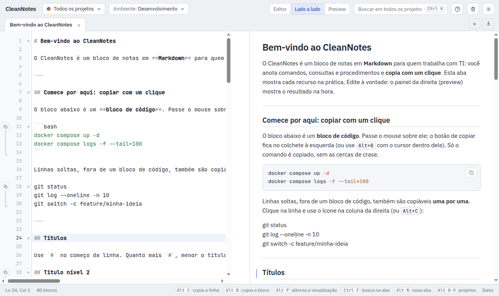
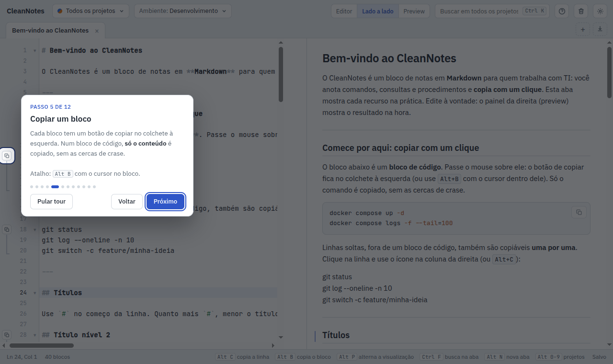
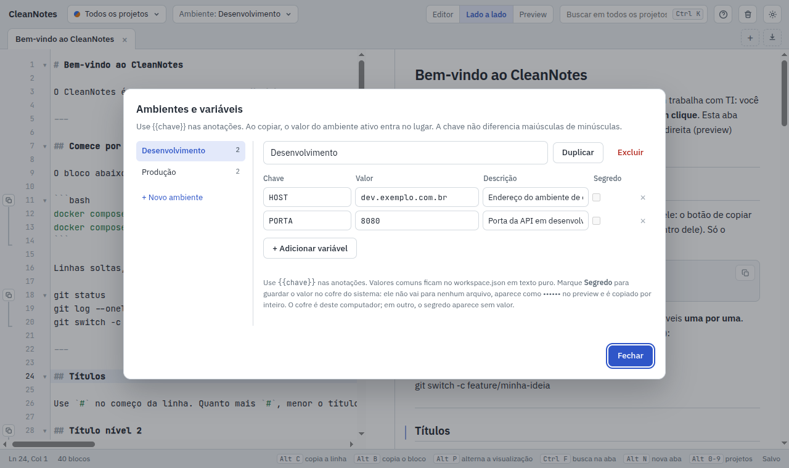

# CleanNotes

**Bloco de notas em Markdown para quem trabalha com TI.** Você guarda comandos, consultas e procedimentos e **copia com um clique**: uma linha, um bloco ou um bloco de código inteiro, já com o host, a porta ou a senha certos para o ambiente em que você está.



- **Copiar sem sofrer:** botão por linha (`Alt+C`) e por bloco (`Alt+B`). Num bloco de código, só o conteúdo é copiado, sem as cercas de crase.
- **Variáveis como no Postman:** defina `HOST` em um ambiente "Desenvolvimento" e escreva `{{host}}/login`; ao copiar, sai `dev.exemplo.com.br/login`. Senhas ficam no cofre do sistema.
- **Notas são arquivos `.md` comuns**, em pastas por projeto. Dá para guardá-las no OneDrive, no Dropbox ou num repositório Git.
- **Editor de verdade (CodeMirror 6):** desfazer por aba, buscar e substituir, dobrar seções, vários cursores, rápido mesmo com milhares de linhas.
- **Preview ao lado**, com realce de bash, sql, json, yaml e java.
- **Projetos com cor**, lixeira, importar e exportar `.md`, atalho global para abrir o app por cima de tudo.
- **Funciona 100% offline.** Feito com [Tauri 2](https://tauri.app) (Rust) e JavaScript: leve e nativo, sem Electron.

---

## Instalação, passo a passo

Leva uns 15 minutos na primeira vez (a maior parte é a compilação do Rust). Escolha o seu sistema no **Passo 1**; do **Passo 2** em diante é igual para todos.

### Passo 1: instale os pré-requisitos

Você precisa de **Git**, **Node.js 22 LTS** (mínimo 20.19), **Rust** e das bibliotecas de compilação do seu sistema.

<details open>
<summary><b>Windows 10/11</b></summary>

1. **Git:** https://git-scm.com/download/win (aceite as opções padrão).
2. **Microsoft C++ Build Tools:** baixe o "Build Tools for Visual Studio" em https://visualstudio.microsoft.com/visual-cpp-build-tools/ e, no instalador, marque a carga de trabalho **"Desenvolvimento para desktop com C++"**.
3. **WebView2:** já vem no Windows 10 atualizado e no Windows 11. Se faltar: https://developer.microsoft.com/microsoft-edge/webview2/
4. **Rust:** instale pelo https://rustup.rs (baixe o `rustup-init.exe` e aceite o padrão `stable-msvc`).
5. **Node.js 22 LTS:** https://nodejs.org (instalador "LTS").
6. **Feche e abra o terminal de novo** (PowerShell ou Prompt de Comando) para ele enxergar o que foi instalado.

</details>

<details>
<summary><b>macOS</b></summary>

```bash
xcode-select --install                                   # ferramentas de linha de comando da Apple
curl --proto '=https' --tlsv1.2 -sSf https://sh.rustup.rs | sh   # Rust (aceite o padrão)
brew install node                                        # ou instale o Node 22 LTS por https://nodejs.org
```

Feche e abra o terminal de novo depois do Rust.

</details>

<details>
<summary><b>Linux (Ubuntu/Debian)</b></summary>

```bash
sudo apt update
sudo apt install -y git build-essential curl wget file pkg-config \
  libwebkit2gtk-4.1-dev libxdo-dev libssl-dev \
  libayatana-appindicator3-dev librsvg2-dev libdbus-1-dev
curl --proto '=https' --tlsv1.2 -sSf https://sh.rustup.rs | sh   # Rust (aceite o padrão)
```

Instale o Node 22 LTS (o `apt` costuma trazer uma versão antiga demais). O jeito mais simples é o [nvm](https://github.com/nvm-sh/nvm):

```bash
curl -o- https://raw.githubusercontent.com/nvm-sh/nvm/v0.40.1/install.sh | bash
# feche e abra o terminal, e então:
nvm install 22
```

Para guardar **segredos** no cofre do sistema, o Linux precisa de um serviço de chaves em execução (o GNOME e o KDE já trazem; em ambientes mínimos: `sudo apt install gnome-keyring`).

> **Atalho no Ubuntu/Debian:** se você só quer **instalar o app**, rode `./install.sh` depois do Passo 2. Ele instala as dependências, compila e instala o pacote `.deb` sozinho.

</details>

**Confira se deu certo** (cada comando deve mostrar uma versão):

```bash
git --version
node --version      # v20.19 ou mais novo (recomendado: v22)
npm --version
rustc --version
cargo --version
```

### Passo 2: baixe o projeto

```bash
git clone https://github.com/danilocesarmendes/CleanNotes.git
cd CleanNotes
```

### Passo 3: instale as dependências

```bash
npm install
```

Isso baixa o editor (CodeMirror), o Vite e o Tauri CLI. O Rust baixa o resto sozinho no passo seguinte.

### Passo 4: rode o app

```bash
npm run dev
```

- A **primeira vez demora** (de 3 a 10 minutos): o Rust compila o Tauri e as bibliotecas. As próximas vezes levam segundos.
- Uma janela do **CleanNotes** abre sozinha, com um **tour guiado de primeiros passos** e uma aba de exemplos.
- Mexeu em algo dentro de `src/`? A tela atualiza na hora. Mexeu em `src-tauri/`? O app recompila e reabre.

Pronto: você já está usando o CleanNotes.

### Passo 5 (opcional): gere o instalador

```bash
npm run build
```

Os instaladores ficam em `src-tauri/target/release/bundle/`:

| Sistema | Onde |
|---|---|
| Windows | `msi/` e `nsis/` |
| macOS | `dmg/` |
| Linux | `deb/`, `rpm/` e `appimage/` |

No Linux, para gerar só o `.deb` (mais rápido): `npm run build -- --bundles deb`.
O instalador não é assinado digitalmente, então o Windows (SmartScreen) e o macOS (Gatekeeper) podem avisar na primeira execução. Para uso próprio, é só confirmar.

**Só quer ver a interface, sem compilar o Rust?** `npm run dev:web` e abra http://127.0.0.1:1420 no navegador. Nesse modo as notas ficam no `localStorage` do navegador, e recursos que dependem do sistema (pasta das notas, atalho global, cofre de segredos) não existem.

**Atualizar depois:** `git pull` e `npm install`.
**Desinstalar no Linux (via `install.sh`):** `./install.sh --uninstall` (mantém as notas) ou `./install.sh --purge` (apaga as notas também).

---

## Primeiros passos no app

Na primeira abertura, o CleanNotes mostra um **tour guiado** de 12 passos (pule com `Esc`, reveja com o botão **?** ou `F1`) e abre uma única aba, **"Bem-vindo ao CleanNotes"**, com exemplos de cada recurso: títulos, linhas separadoras, negrito e itálico, listas, tarefas, tabelas, citações, blocos de código e variáveis. Edite à vontade; quando não precisar mais, feche a aba (ela vai para a lixeira).



Um roteiro de 2 minutos:

1. Clique no ícone de copiar ao lado do primeiro bloco de código da aba de exemplos e cole em outro lugar.
2. Crie uma aba com **+** (ou `Alt+N`) e escreva `curl https://{{host}}/health`.
3. Em **Ambiente**, escolha "Produção", copie a linha de novo e veja o host mudar.
4. Crie um **projeto** (botão ao lado do logo) e mova suas abas para ele pelo menu "Mover para projeto…" (botão direito na aba).

---

## Recursos

### Copiar
- **Linha** (`Alt+C`): o botão aparece na coluna da direita, na linha do cursor e na linha sob o mouse.
- **Bloco** (`Alt+B`): o botão fica no colchete à esquerda. Um bloco de texto vai de uma linha em branco (ou de um `---`) até a próxima; um bloco de código é o conteúdo entre as cercas ` ``` `.
- Fora de código, linhas que começam com `#` ou `//` ficam de fora da cópia do bloco, para você comentar sem sujar o comando.

### Variáveis e segredos



- **Ambiente** (barra de cima, `Alt+E`) é um conjunto de variáveis: **chave, valor e descrição**, como no Postman. Crie "Desenvolvimento", "Produção" etc.
- Escreva `{{chave}}` na nota. A chave não diferencia maiúsculas (`HOST` = `{{host}}`). Ao copiar (linha, bloco ou preview), o valor do ambiente ativo entra no lugar.
- Variável **sem valor** não é trocada em silêncio: fica como está, em vermelho, e a cópia avisa.
- Marque **Segredo** para senhas e tokens: o valor vai para o **cofre do sistema** (Credential Manager no Windows, Keychain no macOS, Secret Service no Linux) e **nunca para um arquivo**. No preview aparece `••••••`; ao copiar, vai o valor real. O cofre é deste computador: ao levar as notas para outro, o segredo aparece sem valor até você digitá-lo lá.

### Projetos, abas e lixeira
- **Projetos** têm nome e cor (9 cores) e aparecem nas abas com faixa de cor e sigla (`Loja Online` → `LO`). O nome da aba é único dentro do projeto. Atalhos: `Alt+0` (todos) e `Alt+1` a `Alt+9`.
- **Botão direito na aba:** renomear (`F2`), mover para outro projeto, exportar como `.md`, fechar.
- **Lixeira:** fechar uma aba com conteúdo a move para a lixeira (botão no canto superior), de onde você restaura com o conteúdo idêntico. Aba em branco é apagada de vez. Excluir um **projeto** nunca apaga notas: as abas vão para "Sem projeto".
- **Importar** um `.md`/`.markdown`/`.txt` (botão ao lado do **+**, até 5 MB) e **exportar** uma aba como `.md`.

### Editor
Numeração, **dobrar** seções e blocos (setas ao lado dos números), **buscar e substituir** (`Ctrl+F`), **desfazer por aba** (`Ctrl+Z`: cada aba guarda o próprio histórico), **vários cursores** (`Alt`+clique, `Ctrl+D`), realce de Markdown e das `{{variáveis}}`. Em **Configurações > Editor** dá para ligar o realce de sintaxe também dentro dos blocos de código.

### Configurações (engrenagem)
- **Pasta das notas:** troque para uma pasta do OneDrive/Dropbox/Git, com a opção de mover as notas existentes.
- **Atalho global:** `Ctrl+Shift+Espaço` (configurável) mostra o app por cima de tudo e foca o editor.
- **Iniciar com o sistema** (abre escondido, na bandeja) e o ícone na bandeja do sistema.

---

## Atalhos

| Atalho | Ação |
|---|---|
| `Alt+C` | copia a linha do cursor |
| `Alt+B` | copia o bloco do cursor |
| `Alt+N` | nova aba |
| `Alt+P` | alterna Editor / Lado a lado / Preview |
| `Alt+E` | escolhe o ambiente de variáveis |
| `Alt+0` / `Alt+1…9` | todos os projetos / projeto na ordem do menu |
| `Ctrl+K` | busca em todas as abas e projetos |
| `Ctrl+F` | busca e substitui dentro da aba |
| `Ctrl+Z` / `Ctrl+Shift+Z` | desfaz / refaz (por aba) |
| `Ctrl+Shift+[` / `]` | dobra / expande o bloco ou a seção sob o cursor |
| `Alt`+clique, `Ctrl+D` | vários cursores |
| `F2` | renomeia a aba |
| `F1` | abre o tour de primeiros passos |
| `Ctrl+Shift+Espaço` | (global) traz o app para a frente |

No macOS, use `Cmd` onde estiver `Ctrl` nos atalhos do editor.

---

## Onde ficam as notas

Cada aba é um arquivo `.md` comum; projetos e abas ficam listados em `workspace.json`:

```
workspace/
├── workspace.json
├── git-do-dia-a-dia.md              aba sem projeto
├── loja-online/anotacoes-aws.md     aba do projeto "Loja Online"
└── .lixeira/20261116-153012-nota.md aba fechada (data em UTC no nome)
```

| Sistema | Pasta padrão |
|---|---|
| Windows | `%APPDATA%\dev.cleandev.cleannotes\workspace\` |
| macOS | `~/Library/Application Support/dev.cleandev.cleannotes/workspace/` |
| Linux | `~/.local/share/dev.cleandev.cleannotes/workspace/` |

Passe o mouse sobre "Salvo", no canto inferior direito, para ver o caminho. A pasta e o atalho global ficam em `config.json`, fora da pasta das notas (`%APPDATA%\dev.cleandev.cleannotes\` no Windows, `~/.config/dev.cleandev.cleannotes/` no Linux). Fazer **backup** é copiar a pasta; apagá-la devolve o app ao estado de primeira abertura.

Renomear ou mover uma aba move o arquivo; renomear um projeto renomeia a pasta. As gravações são atômicas (arquivo temporário + rename) e acontecem 300 ms depois da última tecla, ao sair do editor e quando a janela perde o foco.

---

## Solução de problemas

| Sintoma | O que fazer |
|---|---|
| `cargo: command not found` / `rustc: command not found` | Feche e abra o terminal depois de instalar o Rust. No Linux/macOS: `source "$HOME/.cargo/env"`. |
| Windows: `link.exe not found` ou erro de compilação C++ | Falta a carga **"Desenvolvimento para desktop com C++"** nas Build Tools (Passo 1). |
| Erro de Node/Vite sobre a versão (`requires Node.js 20.19+`) | Atualize para o Node 22 LTS (`node --version` para conferir; com nvm: `nvm install 22`). |
| Linux: `Package webkit2gtk-4.1 was not found` (ou `dbus-1`) | Rode de novo o `sudo apt install …` do Passo 1 inteiro (inclui `libwebkit2gtk-4.1-dev` e `libdbus-1-dev`). |
| `Port 1420 is already in use` | Há outro `npm run dev` aberto (ou outro programa na porta). Feche-o e rode de novo. |
| A janela abre **em branco** em modo dev | Você mudou `tauri.conf.json` ou `package.json` com o app aberto. Pare (`Ctrl+C`) e rode `npm run dev` de novo. |
| A primeira compilação parece travada | Normal: o Rust compila centenas de bibliotecas. Acompanhe o terminal; só acontece na primeira vez. |
| Marquei "Segredo" e deu erro de cofre | O sistema não tem serviço de chaves ativo (Linux sem GNOME Keyring/KWallet). Instale/inicie um; o valor **nunca** cai para texto puro. |
| O atalho global não abre o app (Linux) | Sessões **Wayland** puras não permitem atalho global. Use uma sessão X11 ou o ícone da bandeja. |
| `Alt+C` digita "ç" (macOS) | O app lê a tecla pelo código físico (não foi testado no macOS ainda). Se falhar, use o botão de copiar ao lado da linha e abra uma issue. |
| AppImage falha em `linuxdeploy` | Gere só o `.deb`: `npm run build -- --bundles deb` (e não rode dois builds ao mesmo tempo). |

---

## Para quem quer mexer no código

```
CleanNotes/
├── package.json              scripts: dev, build, dev:web, build:web, test:front
├── vite.config.js            Vite: raiz em src/, saída em dist/ (porta 1420)
├── install.sh                instalador para Ubuntu/Debian
├── docs/                     imagens deste README
├── src/                      front-end (módulos ES, empacotados pelo Vite)
│   ├── index.html
│   ├── styles.css
│   ├── main.js               projetos, abas, preview, cópia, busca, modais, tour e persistência
│   ├── editor.js             o editor (CodeMirror 6): calhas, botões de cópia, dobrar, variáveis
│   ├── tour.js               o tour guiado de primeiros passos
│   ├── welcome.md            a aba de exemplos da primeira abertura
│   ├── blocks.js             lógica de blocos e de cópia (pura, sem DOM)
│   ├── vars.js               variáveis {{chave}} (pura, sem DOM)
│   ├── highlight.js          realce de bash, sql, json, yaml e java
│   ├── util.js               esc() e plural()
│   ├── *.test.js             testes dos módulos puros
│   └── fonts/                IBM Plex Sans e JetBrains Mono
└── src-tauri/                backend Rust
    ├── tauri.conf.json       nome, janela, identificador e ícones
    ├── capabilities/         permissões da janela
    └── src/lib.rs            workspace, abas, projetos, lixeira, ambientes, segredos, configurações
```

O `main.js` detecta se está dentro do Tauri; no navegador (`npm run dev:web`) ele usa o `localStorage`, o que serve para mexer só no visual.

**Testes:**

```bash
npm run test:front                        # blocos, cópia, variáveis e realce (22 testes, via node --test)
cd src-tauri && cargo test                # backend: arquivos, lixeira, ambientes, segredos, migração (11 testes)
cd src-tauri && cargo test -- --ignored   # + cofre real do sistema (rode no seu computador)
```

**Para contribuir:** crie um branch, faça a mudança, rode os testes acima e abra um Pull Request descrevendo o que mudou e como testar. Mudanças no formato dos arquivos (`workspace.json`) pedem cuidado: quem já usa o app não pode perder notas.

**Ícones:** `app-icon.png` é o ícone base; `npx tauri icon app-icon.png` regenera os ícones.

---

## Licença

Distribuído sob a licença [MIT](LICENSE). Você pode usar, copiar, modificar e distribuir, mantendo o aviso de copyright.
